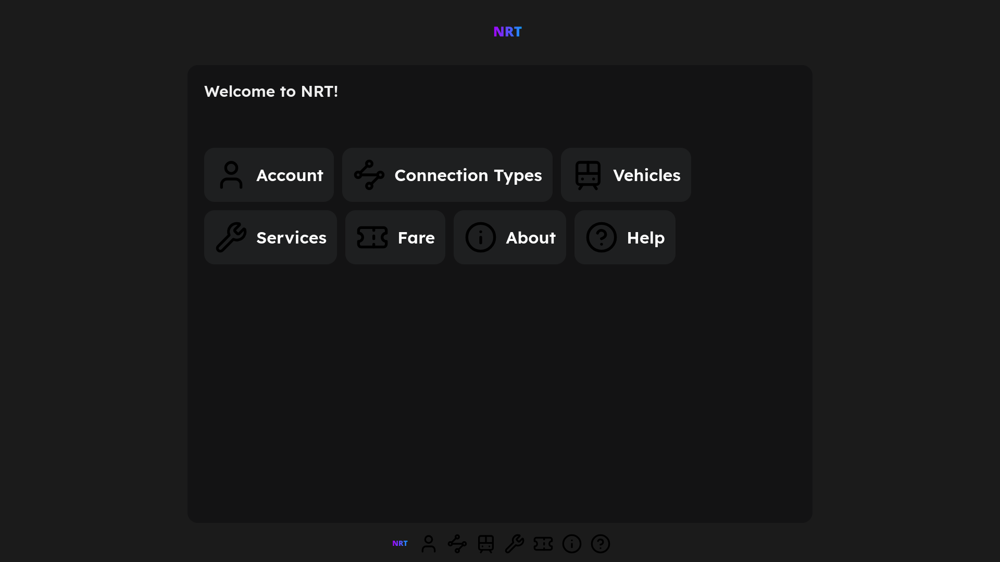

# Nether Republic Transport

## Preview (Screenshots)



## Requirements

- Git
- Node.js
- npm

## Cloning Repository

```bash
git clone https://github.com/dqnx19/nrt.git
cd nrt
```

## Installing npm Dependencies

```bash
npm install
```

## Starting the Server

```bash
node server.js
```

## Opening in Browser

Open the following URL in your browser:

http://localhost:3000